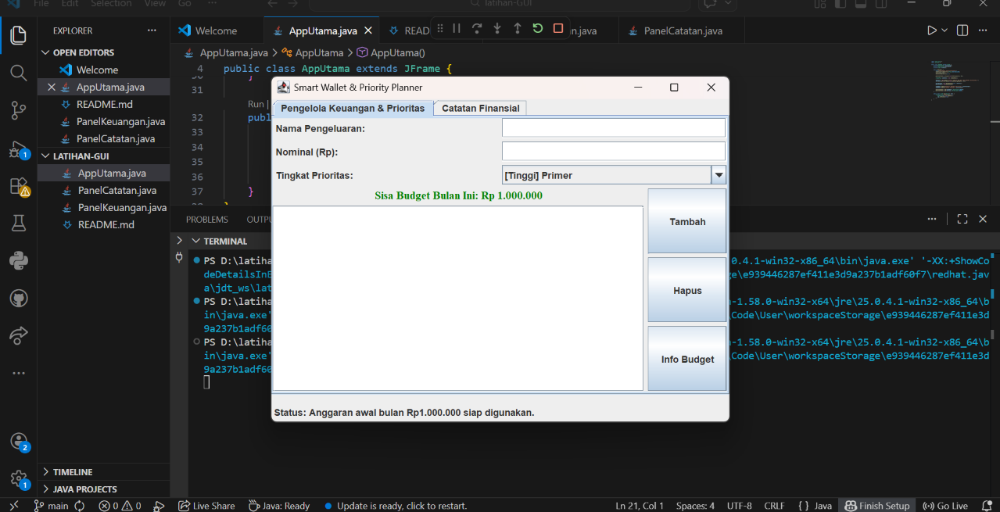
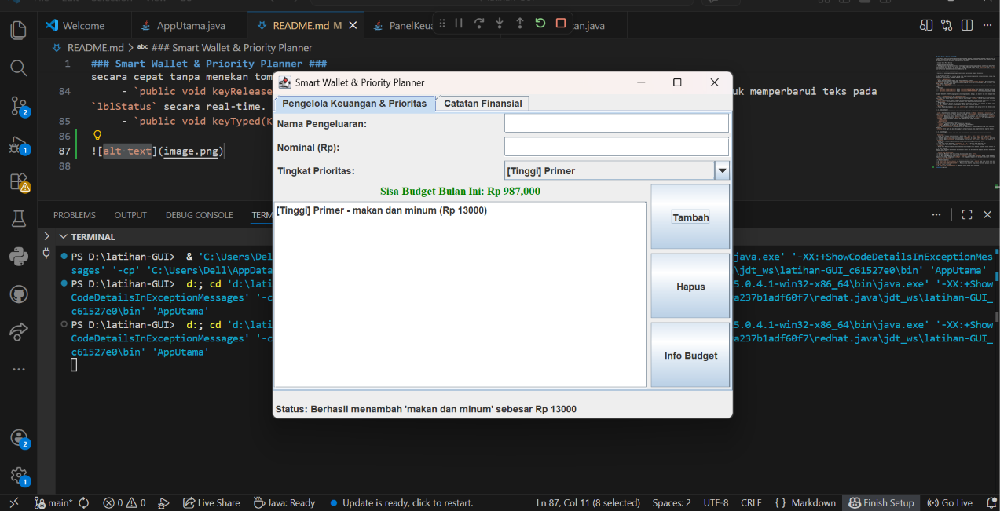

### Smart Wallet & Priority Planner ###

-- Smart Wallet & Priority Planner adalah aplikasi manajemen keuangan bulanan berbasis Desktop Graphical User Interface (GUI) menggunakan teknologi Java Swing. Aplikasi ini dirancang khusus untuk membantu mahasiswa atau pengguna dalam mengelola anggaran bulanan sebesar Rp1.000.000 secara terencana berdasarkan skala prioritas kebutuhan.

- Tinjauan Teori API & GUI Java 

-- Berdasarkan materi perkuliahan:
--- API (Application Programming Interface): Seperangkat fungsi standar yang disediakan oleh OS atau Bahasa Pemrograman Java yang dikelompokkan ke dalam package. Pada proyek ini, package utama yang diimpor adalah `javax.swing.*` dan `java.awt.*`.
--- Swing / JFC (Java Foundation Class): Library GUI Java berbasis turunan AWT yang menyediakan komponen lengkap, mendukung Pluggable Look-and-Feel, dan direkomendasikan untuk pembelajaran PBO.

- Analisis Rinci Komponen GUI pada Aplikasi

-- Aplikasi ini dikembangkan dengan mengimplementasikan 5 pilar utama komponen Swing Java:

--- 1. Top-Level Container
Merupakan kontainer dasar atau landasan paling utama tempat komponen-komponen GUI lainnya diletakkan. Setiap Top-Level Container memiliki content pane yang berfungsi menampung komponen visual.

- `JFrame` (`AppUtama.java`):
  - Fungsi: Berfungsi sebagai jendela utama (main frame) dari aplikasi.
  - Pengaturan Close Operation: Menggunakan `setDefaultCloseOperation(JFrame.EXIT_ON_CLOSE)`. Berdasarkan materi PBO, mode `EXIT_ON_CLOSE` berfungsi untuk menghentikan eksekusi program secara total serta menghapus frame dari memori (memory allocation freed) ketika pengguna menutup jendela utama.
- `JDialog` via `JOptionPane`:
  - Fungsi: Digunakan untuk menampilkan jendela dialog turunan/pop-up interaktif yang bersifat tidak berdiri sendiri (membutuhkan parent frame).
  - Penerapan:
    - `JOptionPane.showMessageDialog()` dengan `JOptionPane.ERROR_MESSAGE` untuk peringatan input kosong atau bukan angka.
    - `JOptionPane.showMessageDialog()` dengan `JOptionPane.WARNING_MESSAGE` saat pengeluaran melebihi sisa budget Rp1.000.000.
    - `JOptionPane.showMessageDialog()` dengan `JOptionPane.INFORMATION_MESSAGE` untuk menampilkan panduan penggunaan.

--- 2. Intermediate Container
Merupakan kontainer perantara yang digunakan untuk mengelompokkan, membagi, dan mengatur tata letak komponen-komponen[cite: 9, 63].

- `JPanel` (`PanelKeuangan.java` dan `PanelCatatan.java`):
  - Fungsi: Digunakan sebagai wadah pengelompokan elemen secara rinci, seperti mengelompokkan form input, area list pengeluaran, dan panel tombol aksi. Secara default, `JPanel` memiliki layout manager `FlowLayout` sebelum diubah sesuai kebutuhan.
- `JTabbedPane`:
  - Fungsi: Digunakan untuk menyusun tampilan antarmuka menjadi tumpukan halaman ber-tab. Dalam materi PBO, komponen ini memfasilitasi konsep `CardLayout` secara praktis, di mana hanya satu panel yang ditampilkan dalam satu waktu.
  - Pembagian Tab:
    1. Tab 1 ("Pengelola Keuangan dan Prioritas"): Memuat panel input transaksi, sisa anggaran, dan daftar riwayat.
    2. Tab 2 ("Catatan Finansial"): Memuat panel evaluasi dan perencanaan belanja.
- `JScrollPane`:
  - Fungsi: Menyelimuti komponen `JList` dan `JTextArea` agar menyediakan bilah gulung (scroll bar) dinamis jika jumlah data pengeluaran atau baris catatan melebihi ukuran area tampilan.

--- 3. Atomic Component
Komponen tingkat atomik yang memiliki fungsi spesifik dan digunakan langsung oleh pengguna untuk berinteraksi dengan aplikasi.

- `JLabel`: Digunakan untuk menampilkan teks stasis/label petunjuk (`lblNama`, `lblNominal`, `lblPrioritas`), teks status di bagian bawah frame (`lblStatus`), serta teks dinamis penunjuk sisa budget (`lblSisaBudget`). Method yang digunakan meliputi `setText()` dan `setForeground()`.
- `JTextField`: Wadah untuk menerima masukan teks satu baris dari pengguna, yaitu nama pengeluaran (`txtPengeluaran`) dan nominal angka (`txtNominal`). Memanfaatkan method `getText()` untuk mengambil nilai dan `setText("")` untuk pengosongan form.
- `JComboBox`: Komponen drop-down selection yang memberikan opsi tingkat prioritas:
  - `[Tinggi] Primer`
  - `[Sedang] Sekunder`
  - `[Rendah] Tersier`
- `JButton`: Tombol eksekusi aksi interaktif:
  - `btnTambah`: Memproses kalkulasi dan menambah item pengeluaran.
  - `btnHapus`: Menghapus item terpilih dan mengembalikan saldo anggaran.
  - `btnInfo`: Memunculkan pop-up `JDialog` panduan aplikasi.
- `JList` dan `DefaultListModel`**: Menampilkan daftar komponen entri riwayat pengeluaran yang telah dimasukkan pengguna secara sekuensial.
- `JTextArea`: Area input teks multi-baris pada tab catatan finansial untuk mengetik evaluasi anggaran bulanan. Menggunakan method `setLineWrap(true)` agar teks otomatis berpindah baris saat mencapai batas tepi.

--- 4. Layout Manager
Berfungsi untuk mengatur posisi, tata letak, dan ukuran komponen secara otomatis di dalam suatu kontainer.

- `BorderLayout`:
  - Konsep Teori: Membagi kontainer menjadi 5 daerah utama: `NORTH`, `SOUTH`, `EAST`, `WEST`, dan `CENTER`.
  - Penerapan:
    - Digunakan pada `JFrame` utama untuk meletakkan `JTabbedPane` di wilayah `CENTER` dan `lblStatus` di wilayah `SOUTH`.
    - Digunakan pada `PanelKeuangan` untuk menempatkan form input di `NORTH`, list di `CENTER`, dan tombol di `EAST`.
- `GridLayout`:
  - Konsep Teori: Menyusun komponen dalam matriks baris dan kolom yang berukuran sama rata.
  - Penerapan:
    - Form input disusun menggunakan `GridLayout(3, 2, 5, 5)` (3 baris, 2 kolom dengan gap 5px).
    - Panel tombol aksi disusun menggunakan `GridLayout(3, 1, 5, 5)` secara vertikal seragam.
- `FlowLayout`:
  - Konsep Teori: Menyusun komponen secara sekuensial berurutan dari kiri ke kanan. Digunakan secara internal oleh panel dasar.

--- 5. Event Handling 
Mekanisme untuk menangani dan merespons aksi/kejadian (event) yang dilakukan oleh pengguna. Aplikasi mengimplementasikan 2 Interface Listener standar Java:

1. `java.awt.event.ActionListener`:
   - Deskripsi: Menangani event pemicu berupa klik mouse pada tombol `JButton`.
   - Method Implementasi: `public void actionPerformed(ActionEvent e)`.
   - Alur Kerja Code: Memeriksa sumber event (`e.getSource()`). Jika tombol `btnTambah` diklik, sistem mengambil teks nominal, mengonversi ke integer, mengurangi `sisaBudget`, serta mengupdate tampilan list dan label saldo secara real-time.
2. `java.awt.event.KeyListener`:
   - Deskripsi: Menangani event interaksi papan ketik (keyboard) pada komponen `JTextField`.
   - Method Implementasi:
     - `public void keyPressed(KeyEvent e)`: Mendeteksi penekanan tombol `VK_ENTER` pada field nominal untuk menambahkan pengeluaran secara cepat tanpa menekan tombol "Tambah".
     - `public void keyReleased(KeyEvent e)`: Membaca setiap karakter yang selesai diketikkan pengguna untuk memperbarui teks pada `lblStatus` secara real-time.
     - `public void keyTyped(KeyEvent e)`: Dipasang sesuai kontrak wajib interface.

